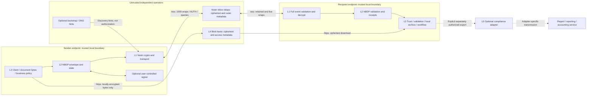

# NBDP transport boundaries and preliminary threat model

**Status:** Architecture proposal for NBDP-004, 2026-10-11. [ADR 0001](../../adr/0001-transport-selection.md) is Proposed. This document assigns responsibilities and candidate security controls; it is not a normative wire specification. Canonical issue IDs are Q01–Q27 in [open-questions.md](open-questions.md); classifications and gates are in [the risk register](architecture-risk-register.md).

## Architectural layers

| Layer | Responsibility | Explicit boundary |
| --- | --- | --- |
| L1 Existing Nostr infrastructure | NIP-01 identities/event hashes/signatures and relay protocol; NIP-17 kinds 14/15 and 10050 inboxes; NIP-44 encryption; NIP-59 seals/wraps; NIP-42 AUTH; optional NIP-65 discovery and NIP-07/46/55 signers | Supplies key-based transport, not business authority, receipts, guaranteed retention or replay-safe business effects |
| L2 NBDP application protocol | Versioned envelopes, logical IDs, commitments, type/format metadata, correlation/revisions, private capabilities, errors, authenticated receipt assertions, replay/conflict rules and observable state transitions | Specifies interoperable meaning; no mandatory vendor SDK, local database, format, accounting system or compliance service |
| L3 Client application | User experience, trust enrollment, document generation/format validation, local custody/storage, business decisions, queues/retries/archives, accounting and payments | Executes protocol rules and owns business authorization/effects; cannot infer a legal representative from a Nostr signature |
| L4 External encrypted attachment storage | Accept/retrieve opaque encrypted bytes, content-addressing, auth, mirroring/fallbacks, independent retention and availability | Hosts do not receive plaintext, file keys or private manifests through core behavior; storage access does not prove recipient validation |
| L5 Optional compliance integrations | Explicitly configured Peppol/reporting, jurisdiction-specific validation/archive/accounting/tax integrations | Outside NBDP transport/conformance; separately authorized disclosure, destinations, rules, credentials and audit policy |

L1 facts are supported by [NIP-01][N01], [17][N17], [44][N44], [59][N59], [42][N42], [65][N65], [46][N46]. L2/L3/L5 boundaries are architectural reasoning under the project principles. Storage scope follows [NIP-B7][NB7], [Blossom BUD-01 retrieval][B01] and [BUD-02 upload][B02]. Security controls proposed here need RFC review and runtime evidence.

## Responsibility matrix

“Contract” means interoperable semantics owned by that layer; “execute” means implementation work. Co-location in one application does not erase the trust boundary.

| Responsibility | L1 | L2 | L3 | L4 | L5 |
| --- | --- | --- | --- | --- | --- |
| Public-key signature/event identity | Existing primitive/format | Bind authenticated key to protocol fields | Custody and verification execution | Verify storage-auth keys only | Adapter credential policy |
| Business organization/representative trust | No proof | Represent endpoint/authority context without mandatory registry | Enroll, pin, authorize, prompt on changes | None | Optional separate attestations |
| Discovery | Signed 10050; optional 10002/05 hints | No-fallback/cache/failure contract | Fetch/cache/choose configured bootstrap and check freshness | Optional 10063 server hints | No core discovery role |
| Message sealing/wrapping | 44/59 algorithm/format | Accepted carrier/validation contract | Execute crypto using reviewed libraries | None | None |
| Attachment encryption | Established AEAD primitive, not NIP-44 file encryption | Exact crypto/encoding/layout and manifest contract | Encrypt/decrypt locally; generate fresh keys/nonces | Store ciphertext only | Receive plaintext only via authorized export |
| Document bytes/hashes/revisions | Event hash primitive | Exact-byte document/operation commitments | Preserve/generate bytes and verify commitments | Ciphertext content-address verification | Optional format-specific interpretation |
| Filename/type/schema privacy | Ciphertext protects inner fields | Keep business metadata/keys inside encrypted payload | Prevent plaintext URL/extensions/log leaks | Sees opaque type/size/hash/access | Controls its own disclosure separately |
| Receipts | Relay OK only; authenticated encrypted message channel | Define recipient assertions, bindings and state/conflicts | Persist facts; apply local authorization before emitting | No business ACK | No core receipt authority |
| Duplicate/replay processing | Identical event IDs assist transport deduplication | Logical identity/freshness/conflict contract | Durable ledger and idempotent effects | Storage auth replay policy | Separate adapter idempotency |
| Offline delivery/reconciliation | Subscriptions, optional 67/77 | Observable retry/failure/recovery contract | Durable outbox, catch-up, backoff, archive | Independent retention/mirrors | No transport availability role |
| Validation of document format | None | Name validator/schema/profile and result scope | Run bounded parser/validator | No transforms of opaque bytes | Optional jurisdiction-specific checks |
| Business acceptance/rejection | None | Define action assertion, not business law | Authorized user/workflow determines outcome | None | May advise workflow outside transport |
| Accounting posting/payments | None | May correlate action IDs; does not post or pay | Own transactions and exactly stated effect scope | None | Optional adapters |
| Key rotation/device removal | No organizational continuity primitive | Continuity/epoch/authorization contract | Verify transitions, revoke sessions, protect backups | No contact trust changes | Independent adapter credential rotation |
| Compliance/reporting/archive mandates | None | No automatic reporting hook or mandatory adapter | Explicit application policy/consent/authorization | Not a reporting service | Entirely independent implementation/policy |

Mandatory protocol behavior is independent of mechanism. For example, L2 may require a durable “received” outcome, while L3 can use any persistence technology that preserves it. A common profile can require interoperable attachment retrieval without naming a mandatory host.

## Architecture diagram and trust boundaries



No compliance edge originates at a relay or core protocol handler. A blob host may use another cloud/CDN, but its API remains replaceable; such providers still learn ciphertext/access metadata. A remote signer outside the endpoint boundary receives plaintext for NIP-44 RPC operations and must be treated as another trusted endpoint, not an opaque untrusted service [NIP-46][N46].

| Boundary | Trusted for | Not trusted for | Control |
| --- | --- | --- | --- |
| Contact/alias → pinned endpoint | Nothing until enrollment/verification | Company identity, automatic successor-key selection | TOFU explicitly marked, out-of-band confirmation, key pinning; Q02/Q17 |
| Bootstrap/relay → signed discovery | Signature proves publisher key, not freshness/completeness | Global currentness, honest advertised retention | Retain highest observed list context; detect rollback/conflict; Q03/Q14 |
| Client → signer | Approved crypto operations if user trusts signer | Availability, business authority or exact response without checking | Minimal session permissions; validate returned bytes/key; Q16 |
| Endpoint → relay | Accepted event routing/storage attempts | Plaintext access, retention, truthful history/hints | E2EE, full validation, selected inboxes, reconciliation; Q04/Q13/Q18 |
| Endpoint → blob host | Delivery of exact ciphertext when verified | Plaintext integrity claims, indefinite availability, transformation safety | Hash/AEAD verification, strict size/URL policy, mirrors; Q08/Q19/Q20 |
| Protocol validator → business workflow | Verified technical facts with known provenance | Accounting/legal approval | Separate authorized actions and durable consumer idempotency; Q11/Q15 |
| Client → compliance adapter | Explicit approved export scope | Core conformance or universal jurisdictional truth | Independent credentials/destination/purpose policy; no automatic core export |

## Data flow and carrier responsibilities

The first candidate profile is bilateral. Kind 14 carries text-serialized NBDP control messages and a private document manifest. Kind 15 retains its existing file-message meaning: URL in content, aes-gcm parameters and x/ox hashes inside the encrypted rumor. An R04/R05 correlation rule will bind file messages to the authoritative envelope. A file arriving first can be quarantined pending a matching envelope; it is not an independent import request. Missing files permit only the receipt states whose preconditions are met.

One canonical rumor is wrapped separately to peer and sender. Do not rely blindly on a convenience multi-recipient builder [nostr-tools NIP-17][T17]. General group document semantics are deferred; adding inner recipients discloses the participant set to recipients and changes NIP-17 room membership [NIP-17][N17].

### Discovery and publication failure sequence

```mermaid
sequenceDiagram
  participant C as Sender client
  participant D as Configured discovery sources
  participant I as Advertised inbox relays
  C->>D: Query recipient-signed kind 10050
  D-->>C: Candidate lists or incomplete/unavailable results
  C->>C: Verify publisher, event ID/signature, list policy and contact pin
  alt Valid usable list available
    C->>C: Check sender inbox, create durable operation, prepare wraps
    C->>I: Publish recipient kind 1059 after any required AUTH
    I-->>C: OK accepted or refused
    C->>C: Record each relay result; do not claim peer receipt
  else List absent, invalid, empty, stale beyond policy or conflicting
    C->>C: Discovery-unavailable / not-ready / trust-conflict; keep queued
    Note over C,I: No publication to arbitrary substitute relays
  end
```

Discovery hints locate announcements; they do not override them. Failure may be temporary rather than proof of nonexistence. A raw key alone establishes addressing, not an inbox route. Direct exchange may include a signed inbox announcement. The proposed strict profile checks both recipient and sender inbox readiness before releasing documents; inability to publish a sender copy is tracked as a distinct archival failure, never silently counted as successful sender history. Exact failure taxonomy/cache age is Q03 RFC work [NIP-17 Publishing][N17], [NIP-65][N65], [NIP-05][N05].

### Document and receipt sequence

```mermaid
sequenceDiagram
  participant S as Sender client and local outbox
  participant H as Selected blob hosts
  participant R as Recipient inbox relay
  participant C as Authorized recipient client
  participant W as Local business workflow
  S->>S: Preserve document bytes, encrypt blob locally, build private manifest
  S->>H: Upload ciphertext; mirror exact same encrypted bytes
  H-->>S: Storage descriptor, not recipient acceptance
  S->>R: Kind 1059 wrapping canonical kind 14 envelope / kind 15 file
  R-->>S: OK: relay accepted
  Note over S,R: Separate sender-addressed archive wrap goes to sender inbox
  C->>R: AUTH if required; subscribe / recover
  R-->>C: Ciphertext wraps
  C->>C: Verify outer, seal, rumor, envelope, trust and replay policy
  C->>C: Durably record received envelope / receipt outbox
  C-->>S: Encrypted received assertion via sender inbox
  C->>H: Retrieve ciphertext from permitted URL or mirror
  H-->>C: Ciphertext
  C->>C: Check size and ciphertext hash; AEAD decrypt; check plaintext hash
  C->>C: Run named format validator where supported
  C->>W: Offer verified document with scope and provenance
  W-->>C: Authorized business decision, or pending
  C-->>S: Separate encrypted scoped technical/business assertion
```

Arrows back to sender abbreviate full NIP-17 wrapping/discovery/publication; no direct ACK shortcut is introduced. Failed blob retrieval leaves “received” possible but downloaded/integrity-verified unsupported. Error/receipt emission occurs only to a validated authorized contact, is bounded and does not trigger recursive ACKs. An invalid hostile wrap may be dropped locally without a network response to prevent amplification.

## Validation pipeline

The following is a proposed full validation contract, combining existing NIP requirements with NBDP restrictions. RFCs must distinguish them; libraries may not supply every check [NIP-44][N44], [NIP-17][N17], [NIP-59][N59], [JavaScript helper][T59], [Rust helper][R59].

1. **Before expensive work:** enforce frame/decode size, JSON depth/field/tag limits and unambiguous types. Reject malformed/duplicate envelope keys rather than allowing language-dependent interpretations.
2. **Outer event:** require persistent kind 1059 for the baseline; validate exact NIP-01 event hash, public key and Schnorr signature before decrypting. Validate permitted outer routing tags and expected outer recipient endpoint. Reject ephemeral wrappers for offline profile operations.
3. **Outer payload:** require supported NIP-44 version and resource bounds; validate MAC/padding through a reviewed implementation. Never fall back to NIP-04/plaintext on error.
4. **Seal:** parse bounded signed event, require kind 13 and empty tags, validate event hash/signature before decrypting its content. The initial profile excludes seal expiration tags/disappearing-message features because the pinned specs conflict.
5. **Rumor:** require unsigned event shape, ID/created_at and accepted inner kind; recompute NIP-01-shaped rumor hash. Require seal pubkey = rumor pubkey. Validate bilateral recipient set and timestamps as specified by RFC; randomized outer timestamps are not business issue times.
6. **Copy role:** for inbound business delivery, require the local endpoint in the inner recipients and consistent envelope recipient. For sender archives, require authenticated rumor sender = local endpoint, preserve original remote recipient, and disable incoming business effects. NIP-17 self-copies would otherwise fail a naive inner-recipient check.
7. **Envelope:** parse only the recognized protocol discriminator/version/schema, enforce extension policy, bound sizes, bind sender to seal identity, recipient/context to rumor, and correlation/commitments to the document operation. Unknown required versions/features do not authorize business processing.
8. **Local authorization/replay:** apply pinned contact and action-authority policy, stable operation ID/digest checks, expiry/replay ledger rules and conflict quarantine before external fetches or business effects. A correct signature alone does not pass business authorization.
9. **Attachment:** restrict protocols/redirect targets, download size/time and local/private-network access; verify ciphertext commitment, authenticated decryption and exact plaintext commitment before exposing document bytes to format parsers.
10. **Receipt:** apply the same full transport checks plus expected issuer endpoint/authority, subject logical ID, document/version/commitment, action and prerequisites; durably deduplicate receipts themselves.

Timestamp and replay decisions need Q07/Q12/Q14 rules; broad skew rejection must not reject legitimate retained offline messages. The protocol does not infer trusted time from a signer-controlled timestamp. Invalid envelope/document errors are different from transient relay/blob failures.

## Attachment storage and cryptographic profile

Blossom/NIP-B7 is a preferred **adapter candidate**, not a mandatory host. BUD-03 kind 10063 lists may aid fallback discovery; private manifest sources/fallbacks and hashes remain authoritative for this operation. A discovered server is not automatically trusted or assumed to possess the blob. Mirroring is exact ciphertext replication, not re-encryption [NIP-B7][NB7], [BUD-03][B03], [BUD-04][B04].

| Approach | Assessment |
| --- | --- |
| Blossom opaque upload/retrieval with independent mirrors | Preferred candidate; hash-addressed bytes, published adapter specs and self-hostable model. Q19/Q20 runtime conformance remains open [BUD-01/02][B01], [BUD-11][B11] |
| Generic HTTPS/object storage through a documented adapter | Architecturally possible if it preserves ciphertext/hash/size/fallback/auth semantics; vendor APIs belong in adapters. No automatic conformance assumed |
| NIP-96 | Optional legacy integration only; unrecommended in favor of B7 and auth wording differs from NIP-98 [NIP-96][N96], [NIP-98][N98] |
| Inline document content | Possible only for small bounded data after envelope/size experiments; not a solution for arbitrary business files [NIP-44][N44], [NIP-11][N11] |
| Relay fragmentation, peer-to-peer/IPFS/torrent adapters | Further research; reassembly/resource/privacy/availability semantics not established. No mandatory alternative introduced |

L2 chooses bytes and encryption metadata; L3 encrypts/decrypts; L4 stores bytes. Do not route opaque encrypted documents through optimization/transformation services. NIP-94 field conventions can be used privately without publishing a kind 1063 business metadata index [NIP-94][N94].

**Candidate for investigation, not an approved NIP-17 byte interpretation:** standard AEAD_AES_256_GCM with a 32-byte key, 12-byte nonce, 16-byte tag and ciphertext followed by tag; no implicit normalization/compression. This uses [RFC 5116 §§5.1–5.2][GCM]. Whether existing clients use these precise encodings/layouts must be established before selecting them in R05.

| Detail | Required RFC decision / vector evidence |
| --- | --- |
| Suite/key/nonce/tag | Fix permitted algorithm, exact sizes and verification; reject truncation/unsupported suite |
| Nonce generation | Fresh key per blob is preferred; CSPRNG nonce, no distinct-plaintext key/nonce reuse; retries/mirrors reuse stored ciphertext bytes |
| Binary layout and AAD | Fix tag placement, whether nonce is only metadata, exact associated-data policy; do not guess between clients |
| Key/nonce encoding | Fix one encoding and canonical validation; compare deployed hex/base64 choices. A proposed lowercase-hex candidate is not yet interoperable fact |
| Commitments | x over final encrypted blob; ox over exact original plaintext; authenticated envelope also binds lengths, document revision and file correlation [NIP-17][N17] |
| Privacy | Keys, nonce, original hash, filename, MIME/type/schema and file URL stay private; public opaque MIME/extension preferred |
| Size/fetch | Separate file/frame/decode limits and byte-count checks; reject mismatches/oversize responses before exposing plaintext |
| Downloads | Verify bytes/hash and AEAD; do not trust Content-Type, filename, redirects, ETag or host's reported hash alone |
| Fallbacks | Retrieve the identical ciphertext commitment from another independently chosen host; retain keys privately |
| Thumbnails | Omitted initially; no distinct thumbnail plaintext encrypted with original key/nonce. Same nonce during repeated decryption or identical ciphertext replication is a different operation |

Q08/Q27 remain blockers: a safe candidate construction is not proof of kind 15 interoperability. Tests must cover empty/binary/multibyte bytes, wrong key/nonce/tag, altered/truncated/appended ciphertext, layouts, encoding and mirrors.

## Delivery state, receipts and business authority

The following distinctions are proposed semantics, not final wire enum names. State is per intended endpoint/document/action; group delivery is not inferred from one recipient.

| Outcome | Meaning | What it does not attest |
| --- | --- | --- |
| Locally queued | Durable local operation prepared | Any network transmission |
| Published to relay | Publication attempted/written to connection | Relay acceptance or retention |
| Accepted by relay | That relay returned OK true for that wrap | Recipient reception, durable storage or business acceptance [NIP-01][N01] |
| Received by authorized client | Validated envelope durably recorded under stated endpoint policy | Attachment availability or valid document format |
| Document downloaded | Complete referenced ciphertext obtained | Authenticated plaintext integrity |
| Document integrity verified | Ciphertext commitment, AEAD and plaintext commitment passed | Format validity or business approval |
| Document format validated | Named schema/profile/validator version passed for stated bytes | Legal validity, accounting approval or correctness of business facts |
| Business accepted | Authorized decision for a specifically bound action/document version | Payment, debt admission, statutory delivery or all downstream actions |
| Business rejected | Authorized rejection for that same scope with bounded reason | Global revocation/deletion or technical inability to receive |
| Failed / retryable | Explicit attempt/operation outcome and retry scope | Recipient rejection; missing acknowledgment may remain unknown |

A cryptographically authenticated receipt attests that the recognized issuer key asserted this outcome for the original sender/recipient endpoint pair, logical message ID, exact document commitment/revision, processing action, receipt identity and authority context. Cryptography authenticates the assertion; it does not prove a malicious authorized issuer actually performed the asserted checks. Portable receipt verification after export requires the optional Q05 signed-object profile.

Authenticated assertions of technical facts can merge by validated set union and be received out of order; their provenance is verified, not the honesty of a remote issuer. Business accepted/rejected are competing decisions for one action, not “maximum state.” Proposed conflict rules: identical assertion → deduplicate; compatible facts → retain both; unauthorized assertion → reject; conflicting business outcomes → retain evidence, mark CONFLICT and suspend automatic effects. A deliberate superseding decision must reference prior action/version under a reviewed authority rule. No last-write-wins based on created_at or lexical hash.

For v0.1 propose a single active business-decision authority per scoped action, chosen by the client/business, with other devices allowed to observe and emit limited technical facts if policy permits. This does not impose a mandatory central network service. Independent clients sharing an account secret are indistinguishable cryptographic issuers and need external coordination for one effect across their shared business domain. Removed devices retaining that secret can still sign; session revocation helps only if no account secret was copied.

Stable operation IDs and durable effect/receipt records must survive restart. Prefer one transaction or recoverable record linking local effect and receipt outbox; across separate accounting systems, use an idempotency key or quarantine an ambiguous result rather than blind reimport. A stale restored backup cannot safely resume effects without reconciling its deduplication frontier. No exactly-once network promise is made. Q11/Q12/Q15 require RFCs and E08/E09/E12.

## Measurable offline assumptions

Define H = maximum supported receiver-offline interval, J = maximum wrap timestamp backdating (NIP-17 recommends up to 2 days), S = agreed clock/reconciliation margin, R = retained relay history interval, and D = replay-record horizon.

A proposed operational model needs R ≥ H + J + S when eviction is based on created_at; retention based on arrival has different accounting. Blob retention must cover H, download/retry grace and successful verified local archival. D must cover the accepted message-validity/retry/restore horizon; a number cannot be safely chosen before Q12/Q13 policies. No record horizon permits replay-safe indefinite acceptance after history is discarded.

For later experiments only, propose H = 7 days, R = 10 days, J = 2 days, S = 1 day; retain blobs at least H plus the declared download grace. Product Owner and operations/security review must select actual objectives. Require recovery from at least one surviving advertised inbox relay and one surviving blob replica within the tested horizon, with the sender outbox as retry source. These are conditional lab assumptions, not global guarantees.

Use overlapping subscriptions, boundary-tie handling, persistent seen-ID tracking, optional 67/77, and full catch-up for a newly configured relay within the accepted horizon. A single timestamp watermark can miss late/backdated arrivals. If caps prevent retrieving all equal-timestamp events and no safe reconciliation is available, report incomplete recovery rather than “all delivered.” Honest hints describe that relay's stored matching set; hostile operators can lie. Deleting every wrap/blob makes recovery impossible [NIP-17][N17], [NIP-67][N67], [NIP-77][N77], [NIP-59][N59].

## Preliminary threat model

### Assets and guarantee categories

Assets are plaintext documents and file keys; authoritative operation/receipt state; endpoint keys/session credentials; trusted contact/rotation state; private business metadata; and durable audit/archives. The trusted computing base includes endpoint validation/storage, crypto libraries, randomness, authorized signer and local effect coordination. Relays, discovery sources and blob hosts are outside it.

| Category | Achievable conditional guarantee | Explicit limit |
| --- | --- | --- |
| Confidentiality | Content protected from operators/observers lacking relevant keys under correct E2EE | No FS/PCS; recipients, signers and compromised endpoints can disclose |
| Integrity | Reject altered events/payloads/blobs with full signature/MAC/AEAD/hash checks | Hash alone is not authorization; compromised keys can produce valid forgery |
| Authenticity | Bind assertions to verified key and enrolled local authority context | No automatic company/legal-role identity; a signed assertion may be false |
| Availability | Retry/recover when an accessible retained copy and keys exist | Any/all operators can refuse, delete, withhold or censor |
| Metadata privacy | Hide inner document fields and public sender from the wrap alone | Recipient tags, AUTH/queries, timing/length and stable blob hashes remain |
| Key continuity | Pinned keys plus reviewed transitions/out-of-band recovery can detect some changes | No automatic safe successor after compromise; shared-key device revocation is limited |
| Auditability | Local durable provenance and optional signed objects support defined audits | Naked rumors are not portable signatures; deletion/tampering of local archives or signer compromise undermines evidence |

The guarantees are architectural conditions, not runtime conformance findings. Existing primitive scope follows [NIP-01][N01], [44][N44], [59][N59]; Q01/Q04/Q05/Q08/Q12/Q17 determine profile conditions.

### Adversary register

| Adversary | Capabilities / trust boundary | Assets at risk and achievable guarantees | Limitations / proposed mitigation | Required tests and questions |
| --- | --- | --- | --- | --- |
| T01 Malicious public relay | Records published wraps/queries/AUTH, sends malformed data, lies about OK/history, deletes/censors; endpoint–relay boundary | Content remains encrypted absent keys; full validation can detect modification, not omission | Recipient/access metadata and availability exposed; selected independent operators, outbox and honest failure states | E01/E10/E11/E15; Q01/Q04/Q13/Q14/Q18 |
| T02 Colluding relay operators | Combine timing, size, IP, keys, lists and publication/subscription patterns | Content confidentiality remains conditional; no strong sender/recipient traffic anonymity | AUTH may reveal sender identity; backdating/padding cannot hide actual arrival; limit public metadata, review optional network privacy | E15 and E10; Q01/Q18/Q21 |
| T03 Malicious blob host | Alters/truncates/transforms files, serves huge bodies/redirects, records uploader/readers, deletes replicas | Hash/AEAD checks reject changed bytes; no guarantee of retrieval | Private manifests/keys, opaque content types, bounded redirects/fetch, independent mirrors | E05/E06/E07/E15; Q08/Q09/Q19/Q20/Q21/Q27 |
| T04 Passive network observer | Under authenticated TLS, observes endpoints/IP, packet lengths/timing; may correlate flows without terminating TLS | Plaintext and application tags remain encrypted on links | Traffic-analysis resistance not promised; TLS does not hide endpoints; connection privacy options need evidence | E15; Q01/Q18/Q21 |
| T05 Impersonating counterparty | Creates keys/lookalike aliases, claims a company role, sends signed deceptive documents | Full verification identifies actual key; enrollment policy rejects unexpected key | TOFU does not stop first-contact impersonation; out-of-band check for high-impact authorization, no automatic legal-role inference | E01/E03/E08/E14; Q02/Q03/Q04/Q11/Q17 |
| T06 Compromised long-term key holder | Derives relevant past conversation keys, unwraps retained copies where feasible, forges new signed messages/lists | No historical confidentiality guarantee or authentic source guarantee after relevant compromise | Stop new effects, freeze trust, rotate for future traffic with verified recovery; no retroactive FS; minimize stored secrets | E14 and conditional E16; Q01/Q15/Q16/Q17/Q26 |
| T07 Compromised client device | Reads plaintext/keys/archives, changes local state, invokes signer, alters UI, exports | No content protection from the compromised endpoint itself | Local isolation/custody, narrow signer sessions, protected backups, revocation where possible; local effect scope explicit | E12/E13/E14; Q01/Q12/Q15/Q16/Q17 |
| T08 Malicious authorized participant | Legitimately decrypts and leaks, asserts false validation/acceptance, conflicts with other device decisions | Signatures preserve issuer attribution only within defined proof scope | Cannot cryptographically enforce truthful behavior or prevent onward disclosure; scoped authority, conflict quarantine, optional portable proof | E08/E12/E15; Q02/Q05/Q11/Q15 |
| T09 Replay attacker | Republishes identical/new wrappers around valid operations, floods duplicates, exploits stale ledger/receipt cache | Stable IDs plus durable commitment ledger prevent repeat effects in coordinated domain | No safety once needed records are lost without recovery; bounded parsing/rate/backoff; expiry alone insufficient | E09/E11/E12; Q07/Q10/Q11/Q12/Q14/Q15 |
| T10 Discovery manipulator | Withholds/rolls back announcements, forges signatures or owns misleading aliases, advertises dangerous destinations | Verify signatures/key pins; detect known rollback/contradictions | Valid signature is not freshness; global newest unknown; no arbitrary fallback, explicit cache/stale policy and fetch restrictions | E03/E14/E15; Q02/Q03/Q17/Q19/Q26 |

Additional HTTP token reuse, resource exhaustion and adapter exfiltration are mapped under T03/T09/T10 and E04/E07/E15, not silently treated as solved by cryptography. The matrix contains all ten required adversaries; a future formal threat model can refine them without renumbering Q01–Q27.

### Metadata visibility by observer

| Observer | Direct observations | Inferences / limitations |
| --- | --- | --- |
| Public observer obtaining wraps | Recipient p-tag, outer kind/key/hash/signature, tweaked timestamp and payload length | May correlate copies; cannot read inner document/type/sender from ciphertext alone |
| Receiving relay | Outer event, real arrival time/IP, subscriber filters, possibly sender/recipient AUTH keys | Can associate business endpoints with activity; TLS protects the link, not operator access |
| Authenticated operator | Same operator view plus account/payment/access policy | AUTH is not anonymity; recipient-only access checks constrain other users, not operator |
| Colluding relays | Aggregated publication/query/timing/length and identity metadata | Wider correlation; no guaranteed traffic unlinkability |
| Blob host/CDN | Ciphertext hash/bytes/size, URLs/extensions/types, upload/download IP/time, storage AUTH keys | Can correlate mirrored ciphertext and endpoints; plaintext naming/type leaks if clients include them outside encryption |
| Passive network observer | TLS connection endpoints, timing/traffic sizes, potentially network-visible DNS information | Does not automatically see p-tags, JSON, AUTH keys or file paths without TLS termination/compromise |
| Compromised client or signer | Accessible plaintext, file keys, local history, operation/receipt state | E2EE cannot defend against that trusted endpoint |
| Intended recipient | Full private envelope, original bytes and participant metadata | Can retain/share data; no cryptographic prevention of onward disclosure |
| Public profile/directory observer | Published NIP-05/profile and relay/server lists | Correlation to organizations/services may exist independently of encrypted messages |

Distinguish content confidentiality, sender anonymity, recipient anonymity and traffic-analysis resistance in product descriptions. The baseline aims at the first and reduced sender exposure to public event readers; it does not promise the other three. Stronger claims need Q01/Q18/Q21 evidence.

## Layer-to-question traceability

This matrix preserves the canonical unresolved research IDs across layer ownership; a question can cross boundaries without acquiring a second classification. The [risk register](architecture-risk-register.md) owns its single status and acceptance criteria.

| Layer | Canonical questions affecting that boundary |
| --- | --- |
| L1 Nostr transport, crypto, routing and signers | Q03, Q04, Q06, Q07, Q10, Q13, Q14, Q16, Q18, Q24, Q25 |
| L2 Application contract and standardization choices | Q02, Q04, Q05, Q06, Q07, Q08, Q09, Q11, Q12, Q15, Q17, Q20, Q23, Q24, Q26, Q27 |
| L3 Client trust, custody, durable effects and privacy | Q01, Q02, Q03, Q10, Q11, Q12, Q13, Q15, Q16, Q17, Q21 |
| L4 Encrypted blobs, HTTP auth and availability | Q08, Q09, Q13, Q19, Q20, Q21, Q22, Q27 |
| L5 Optional integrations and disclosure boundary | Q01, Q02, Q05, Q09, Q11, Q21; jurisdiction-specific obligations remain outside these core transport questions |

## Optional integrations and permanent independence constraints

Satflux should use the same documented client interface available to independent implementers. NBDP contains no mandatory Satflux account mapping, database identifiers, invoice API, payment processor or permission grant.

A compliance adapter is invoked by an application under an explicit purpose/destination rule, with separate credentials, policy and logs. It may receive chosen bytes/metadata after authorization. The core never automatically publishes an invoice or receipt to a reporting endpoint, registry or third-party analytics service. Adapter outages or refusal are separate workflow outcomes, not evidence that an NBDP receipt was invalid or that NBDP transport is unavailable.

Nothing here states when reporting or particular signatures are legally required. Jurisdiction-specific advisors/adapters determine that separately. Supporting lawful integrations does not make them a universal transport dependency.

Dependencies that must never become mandatory are a government reporting endpoint, Peppol network, central business/identity directory, DNS-owned alias, designated relay/indexer/blob host, vendor cloud/signer/SDK, vendor-specific invoice syntax and centrally issued participation approval. Hosted choices may be offered alongside independent/self-hosted choices.

[NREADME]: https://github.com/nostr-protocol/nips/blob/a79e21d90fce5465b50ef385dd368bba99ec4a0b/README.md
[N01]: https://github.com/nostr-protocol/nips/blob/a79e21d90fce5465b50ef385dd368bba99ec4a0b/01.md
[N05]: https://github.com/nostr-protocol/nips/blob/a79e21d90fce5465b50ef385dd368bba99ec4a0b/05.md
[N07]: https://github.com/nostr-protocol/nips/blob/a79e21d90fce5465b50ef385dd368bba99ec4a0b/07.md
[N09]: https://github.com/nostr-protocol/nips/blob/a79e21d90fce5465b50ef385dd368bba99ec4a0b/09.md
[N11]: https://github.com/nostr-protocol/nips/blob/a79e21d90fce5465b50ef385dd368bba99ec4a0b/11.md
[N17]: https://github.com/nostr-protocol/nips/blob/a79e21d90fce5465b50ef385dd368bba99ec4a0b/17.md
[N40]: https://github.com/nostr-protocol/nips/blob/a79e21d90fce5465b50ef385dd368bba99ec4a0b/40.md
[N42]: https://github.com/nostr-protocol/nips/blob/a79e21d90fce5465b50ef385dd368bba99ec4a0b/42.md
[N44]: https://github.com/nostr-protocol/nips/blob/a79e21d90fce5465b50ef385dd368bba99ec4a0b/44.md
[N46]: https://github.com/nostr-protocol/nips/blob/a79e21d90fce5465b50ef385dd368bba99ec4a0b/46.md
[N49]: https://github.com/nostr-protocol/nips/blob/a79e21d90fce5465b50ef385dd368bba99ec4a0b/49.md
[N55]: https://github.com/nostr-protocol/nips/blob/a79e21d90fce5465b50ef385dd368bba99ec4a0b/55.md
[N59]: https://github.com/nostr-protocol/nips/blob/a79e21d90fce5465b50ef385dd368bba99ec4a0b/59.md
[N65]: https://github.com/nostr-protocol/nips/blob/a79e21d90fce5465b50ef385dd368bba99ec4a0b/65.md
[N67]: https://github.com/nostr-protocol/nips/blob/a79e21d90fce5465b50ef385dd368bba99ec4a0b/67.md
[N77]: https://github.com/nostr-protocol/nips/blob/a79e21d90fce5465b50ef385dd368bba99ec4a0b/77.md
[N78]: https://github.com/nostr-protocol/nips/blob/a79e21d90fce5465b50ef385dd368bba99ec4a0b/78.md
[N89]: https://github.com/nostr-protocol/nips/blob/a79e21d90fce5465b50ef385dd368bba99ec4a0b/89.md
[N94]: https://github.com/nostr-protocol/nips/blob/a79e21d90fce5465b50ef385dd368bba99ec4a0b/94.md
[N96]: https://github.com/nostr-protocol/nips/blob/a79e21d90fce5465b50ef385dd368bba99ec4a0b/96.md
[N98]: https://github.com/nostr-protocol/nips/blob/a79e21d90fce5465b50ef385dd368bba99ec4a0b/98.md
[NB7]: https://github.com/nostr-protocol/nips/blob/a79e21d90fce5465b50ef385dd368bba99ec4a0b/B7.md
[NEE]: https://github.com/nostr-protocol/nips/blob/a79e21d90fce5465b50ef385dd368bba99ec4a0b/EE.md
[T17]: https://github.com/nbd-wtf/nostr-tools/blob/cb8d22d4c906d99d8996693b37e4d85aa3d5f26e/nip17.ts
[T59]: https://github.com/nbd-wtf/nostr-tools/blob/cb8d22d4c906d99d8996693b37e4d85aa3d5f26e/nip59.ts
[T44]: https://github.com/nbd-wtf/nostr-tools/blob/cb8d22d4c906d99d8996693b37e4d85aa3d5f26e/nip44.ts
[R59]: https://github.com/nostrdevkit/nostr/blob/463f0c2d48e1d3c9e295cc231715d8a3855c65d3/nostr/src/nips/nip59.rs
[R44]: https://github.com/nostrdevkit/nostr/blob/463f0c2d48e1d3c9e295cc231715d8a3855c65d3/nostr/src/nips/nip44/v2.rs
[G44]: https://github.com/nbd-wtf/go-nostr/blob/18369d469538b931c8b80ebf3c77420aec804d95/nip44/nip44.go
[NDK46]: https://github.com/nostr-dev-kit/ndk/blob/4b86acd13fe3c1284fddcb81a7f0d63e491db64a/core/src/signers/nip46/index.ts
[STR]: https://github.com/hoytech/strfry/blob/4cd3cf64850caf47dda46c2a2abbbf3525a64d10/strfry.conf
[RSR]: https://github.com/scsibug/nostr-rs-relay/blob/b5c1f642e4f4c3b9c54f5d18d66f4c53642076b4/config.toml
[MSPEC]: https://github.com/marmot-protocol/marmot/blob/7fabb81b3ed6e2fffeb1b267a0d2ae92b0ab2c89/README.md
[AUDIT]: https://github.com/paulmillr/nip44/blob/ce63c2eaf345e9f7f93b48f829e6bdeb7e7d7964/audit-2023.12.pdf
[B01]: https://github.com/hzrd149/blossom/blob/b5bd2801d1763aa635fc8fea7a76597e0eb18990/buds/01.md
[B02]: https://github.com/hzrd149/blossom/blob/b5bd2801d1763aa635fc8fea7a76597e0eb18990/buds/02.md
[B03]: https://github.com/hzrd149/blossom/blob/b5bd2801d1763aa635fc8fea7a76597e0eb18990/buds/03.md
[B04]: https://github.com/hzrd149/blossom/blob/b5bd2801d1763aa635fc8fea7a76597e0eb18990/buds/04.md
[B06]: https://github.com/hzrd149/blossom/blob/b5bd2801d1763aa635fc8fea7a76597e0eb18990/buds/06.md
[B11]: https://github.com/hzrd149/blossom/blob/b5bd2801d1763aa635fc8fea7a76597e0eb18990/buds/11.md
[B12]: https://github.com/hzrd149/blossom/blob/b5bd2801d1763aa635fc8fea7a76597e0eb18990/buds/12.md
[MLS]: https://www.rfc-editor.org/rfc/rfc9420.html
[GCM]: https://www.rfc-editor.org/rfc/rfc5116.html
